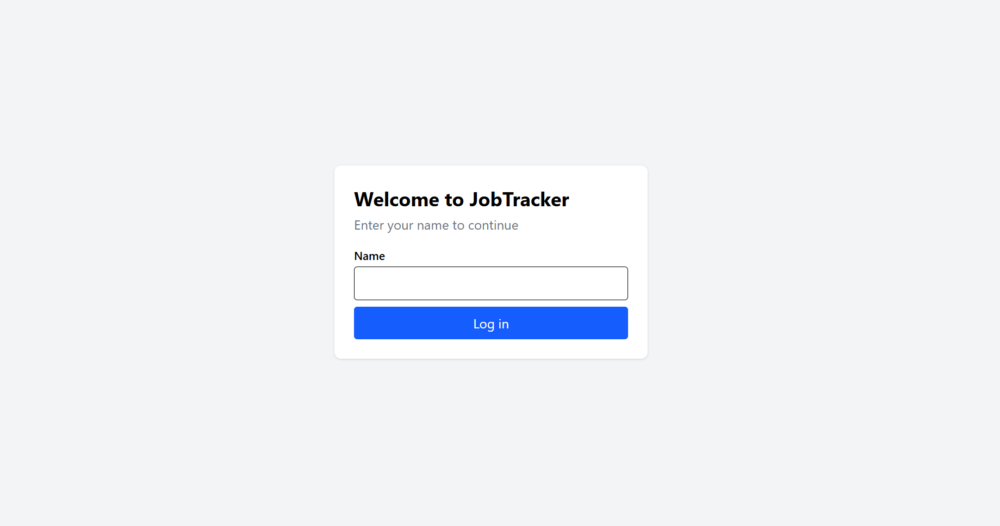
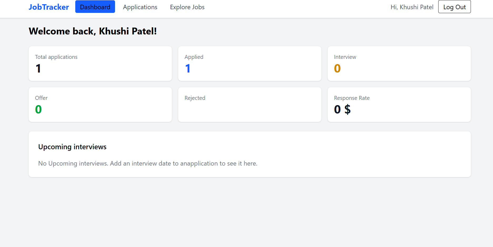
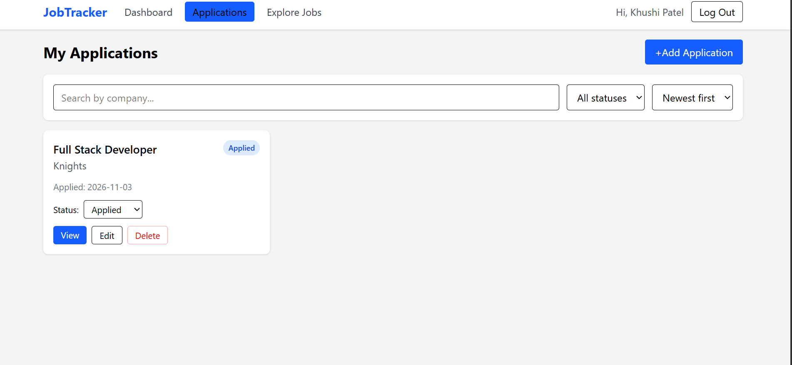
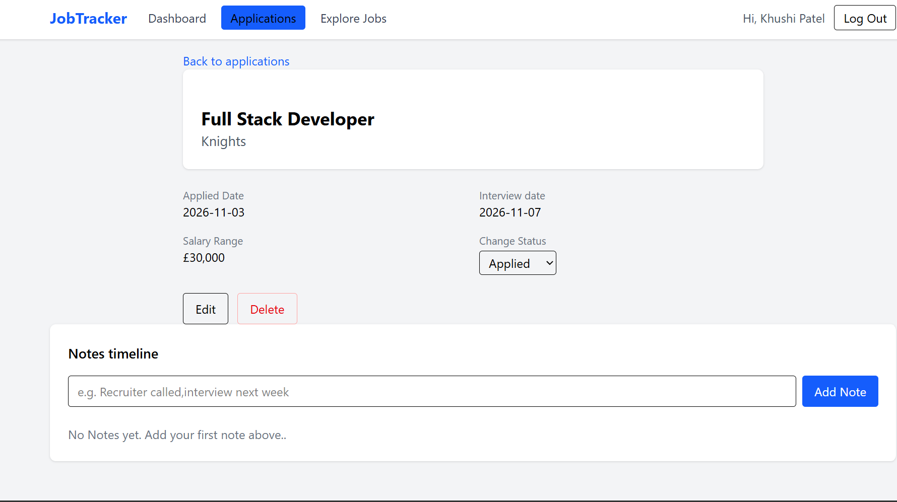
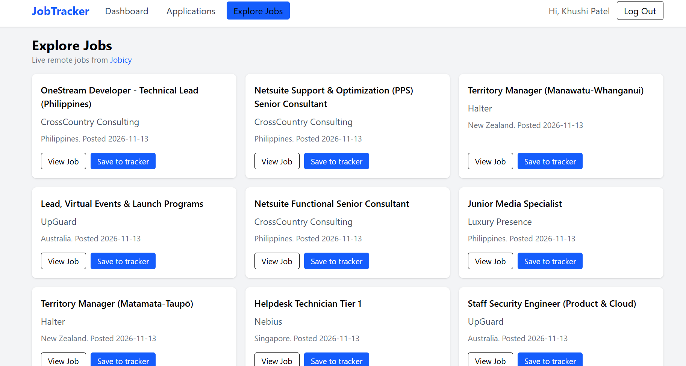

# JobTracker

A React app to manage my own job hunt: track every application, move it through the hiring stages, keep dated notes, and save live remote jobs straight into my tracker.

Milestone 3 – React: Modern UI Development, Option B (Job Application Tracker).

**Live site:** https://job-tracker-m3.vercel.app

## Screenshots

| Login | Dashboard |
|---|---|
|  |  |

| Applications | Application detail |
|---|---|
|  |  |



## Features

- Add, edit and delete applications (company, role, status, applied date, interview date, salary range)
- Status pipeline: Applied → Interview → Offer → Rejected, changed straight from the card
- Dashboard: count per status, response rate %, upcoming interviews
- Search by company, filter by status, sort by date
- Detail page with a dated notes timeline
- Explore Jobs: live remote jobs from the Jobicy API with loading skeletons, error state with retry, and "Save to tracker"
- Fake login (name stored in Context); every page redirects to /login when logged out
- Data saved in localStorage, so it survives a refresh
- Confirm-before-delete popup, designed empty states, responsive on mobile and desktop

## Tech stack

React · Vite · React Router · Context API · Tailwind CSS v4 · Jobicy API · Vercel

No Redux or other state libraries.

## Routes

| Route | Page | Access |
|---|---|---|
| `/login` | Login | Public |
| `/dashboard` | Dashboard | Protected |
| `/applications` | Applications list | Protected |
| `/applications/new` | Add application | Protected |
| `/applications/:id` | Application detail (dynamic) | Protected |
| `/applications/:id/edit` | Edit application (dynamic) | Protected |
| `/explore` | Explore Jobs | Protected |

## Component tree

```text
main.jsx
└── BrowserRouter
    └── AuthProvider              (Context: logged-in user)
        └── ApplicationProvider   (Context: all applications)
            └── App (Routes)
                ├── Login
                └── ProtectedRoute        no user → redirect to /login
                    └── Layout            renders once
                        ├── Navbar
                        └── <Outlet>      pages swap here
                            ├── Dashboard
                            │   ├── StatCard (x6)
                            │   └── EmptyState
                            ├── Applications
                            │   ├── ApplicationFilters
                            │   ├── ApplicationCard → StatusBadge
                            │   ├── EmptyState
                            │   └── ConfirmModal
                            ├── ApplicationForm (add + edit)
                            │   ├── FormInput
                            │   └── FormSelect
                            ├── ApplicationDetail
                            │   ├── StatusBadge
                            │   ├── NotesTimeline
                            │   ├── EmptyState
                            │   └── ConfirmModal
                            ├── ExploreJobs
                            │   ├── JobCard
                            │   ├── JobCardSkeleton
                            │   └── EmptyState
                            └── NotFound
```

## State: what lives where

| State | Where | Why |
|---|---|---|
| Logged-in user | `AuthContext` | Navbar, ProtectedRoute and Dashboard all need it |
| All applications | `ApplicationContext` | Dashboard, Applications, Detail and Explore Jobs all read or change it |
| Search, status filter, sort | `Applications` page (lifted up) | `ApplicationFilters` shows them, the page uses them to filter the cards |
| Form fields while typing | `ApplicationForm` (local) | Only the form needs them until you submit |
| Which card to delete | `Applications` page | The card asks, the page shows the popup |

## Custom hooks

- **`useLocalStorage(key, initialValue)`**: works like `useState`, but saves the value to localStorage in a `useEffect`, so it survives a refresh. Used by both Contexts.
- **`useJobs()`**: fetches jobs from Jobicy in a `useEffect` with `[reloadKey]` as the dependency. Returns `jobs`, `loading`, `error` and `retry`. Caches the result in sessionStorage.

## Run locally

```bash
git clone https://github.com/khushi898/job-tracker-m3.git
cd job-tracker-m3
npm install
npm run dev
```

Then open http://localhost:5173

## Hardest problems I solved

- **Remotive only had 12 jobs.** I tested Jobicy, another keyless API, which returns up to 100 in one request.
- **Worked locally, broke on Vercel.** The hook file was saved as `usejobs.js` but imported as `useJobs.js`. Windows ignores capital letters, but Vercel (Linux) doesn't, so the build failed. I renamed the file to match.
- **404 when refreshing a page on Vercel.** Vercel looked for a real file called `/dashboard`. I added `vercel.json` to send every URL to `index.html`, so React Router can show the right page.
- **Blank Dashboard in production.** I wrote `const { useApplications } = useApplications()`, which uses a variable before it exists. I fixed it to `const { applications } = useApplications()`.

## Credits

Job listings from [Jobicy](https://jobicy.com).